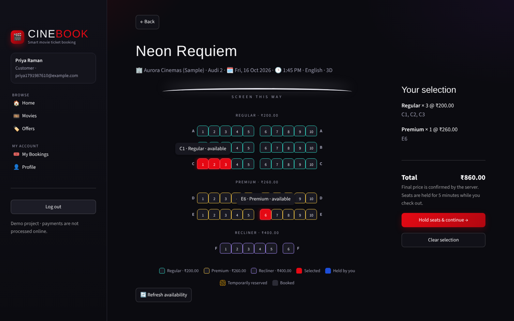
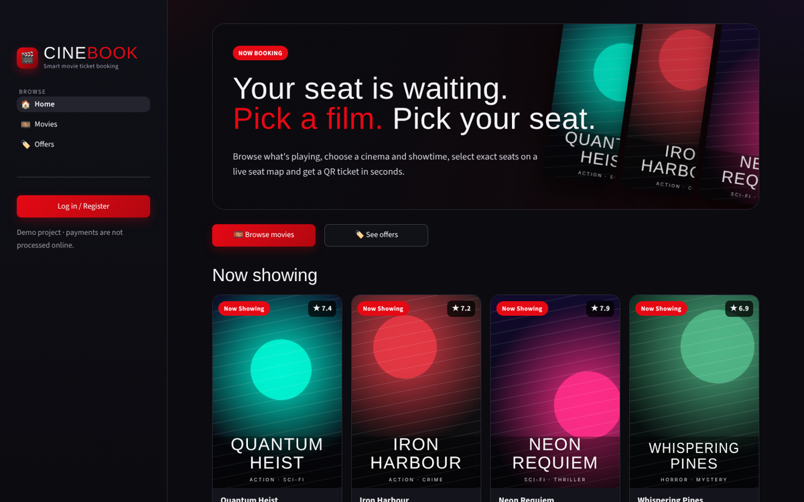
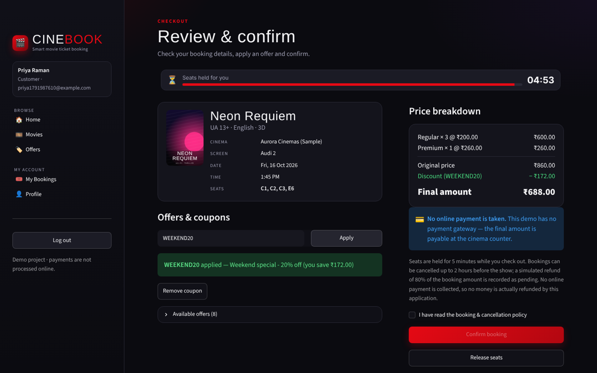
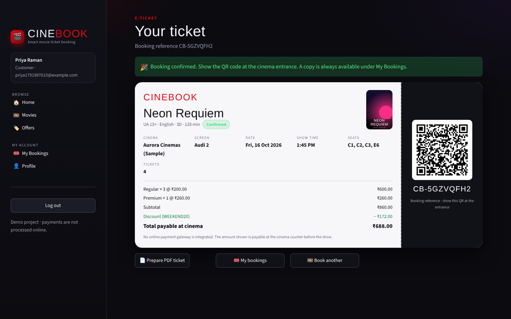
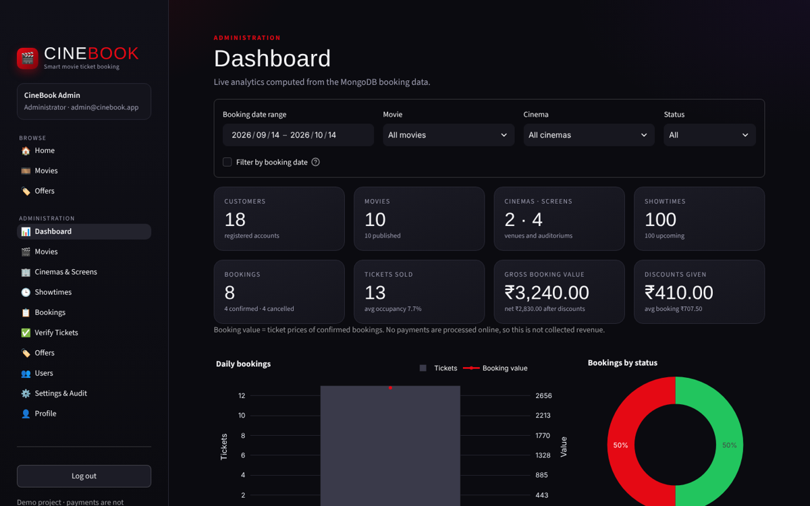
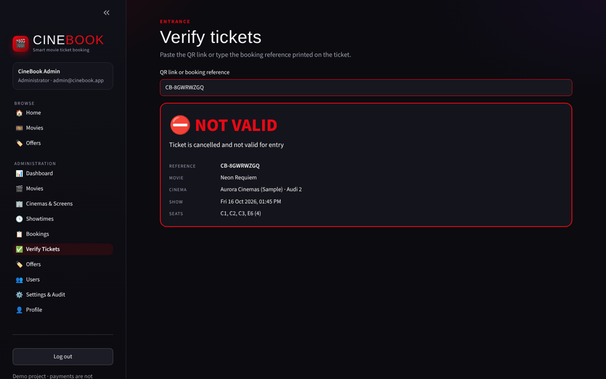

# 🎬 CineBook — Smart Movie Ticket Booking and Management System

CineBook is a complete movie ticket booking application built with **Python Streamlit** (frontend),
**FastAPI** (REST backend) and **MongoDB** (database). Customers browse movies, pick a cinema and
showtime, choose exact seats on a live seat map, apply coupons and receive a QR-code ticket.
Administrators manage movies, cinemas, screens, seat layouts, showtimes, offers and users, and see
live analytics.

> **Payments:** no payment gateway is integrated. Bookings are confirmed with the amount marked
> *payable at the cinema counter*, and refunds on cancellation are recorded as *simulated / pending*.
> The app never claims that money was charged or returned.



| Home | Checkout | Ticket |
|---|---|---|
|  |  |  |

| Admin dashboard | Ticket verification |
|---|---|
|  |  |

---

## Contents

1. [Features](#1-features)
2. [Technology stack](#2-technology-stack)
3. [Project structure](#3-project-structure)
4. [Windows installation (step by step)](#4-windows-installation-step-by-step)
5. [Running the app — two VS Code terminals](#5-running-the-app--two-vs-code-terminals)
6. [Using CineBook](#6-using-cinebook)
7. [How double booking is prevented](#7-how-double-booking-is-prevented)
8. [MongoDB transactions (optional replica set)](#8-mongodb-transactions-optional-replica-set)
9. [Database design](#9-database-design)
10. [REST API](#10-rest-api)
11. [Running the tests](#11-running-the-tests)
12. [Troubleshooting](#12-troubleshooting)
13. [Security notes](#13-security-notes)
14. [Known limitations](#14-known-limitations)

---

## 1. Features

**Customers**
- Register / log in (bcrypt-hashed passwords, JWT sessions, login survives a browser refresh)
- Home page with *Now Showing*, *Coming Soon*, offers, notifications and recently viewed movies
- Movie catalogue with title search, genre / language / status filters, “only with shows” toggle and pagination
- Movie details: poster, genres, languages, duration, certificate, critic rating, audience reviews, cast, watchlist
- Cinema filter, date pills and showtime buttons with live seats-left information
- **Interactive seat map**: screen position, Regular / Premium / Recliner categories and prices,
  available, selected, booked, temporarily reserved and “held by you” states with a legend
- 5-minute seat holds with a live countdown at checkout
- Coupon codes with original price, discount and final amount shown separately
- Digital ticket with QR code, price breakdown and status; **PDF download**
- My Bookings: upcoming, past and cancelled tabs, ticket details, policy-aware cancellation, reviews for attended shows
- Profile, password change, watchlist, recently viewed, in-app notifications

**Administrators**
- Dashboard with KPI cards and Plotly charts (bookings by status, daily & monthly trends, most-booked
  movies, popular showtimes, seat-category sales, occupancy per show, coupon usage) with date / movie /
  cinema / status filters — all computed from MongoDB data
- Movie management (create, edit, publish/unpublish, remove → archived when it has history)
- Cinema & screen management with a **seat-layout editor** (rows, categories, aisles, blocked seats) and live preview
- Showtime scheduling (single or bulk dates × times) with overlap protection and per-show prices
- Booking search by reference, filters, admin cancellation, status history
- Ticket verification page (paste the QR link or type a reference) and check-in
- Offer management (percentage / fixed, min value, max discount, dates, usage and per-customer limits)
- User management (activate / deactivate, change role)
- Configurable booking & cancellation policy, audit log of admin actions, manual cleanup

---

## 2. Technology stack

| Layer | Technology |
|---|---|
| Frontend | Streamlit (Python) + custom CSS, Plotly charts |
| Backend | FastAPI, Uvicorn, Pydantic v2 |
| Database | MongoDB via PyMongo |
| Auth | bcrypt password hashing, JWT (PyJWT), role-based access |
| Tickets | `qrcode` (PNG), ReportLab (PDF) |
| Tests | Pytest + FastAPI TestClient (mongomock fallback) |

Tested versions are listed in `requirements.txt` (tested on Python 3.13; Python 3.11–3.13 recommended).

---

## 3. Project structure

```
CineBook/
├── backend/                  FastAPI application
│   ├── main.py               app factory, CORS, error handlers, startup, cleanup thread
│   ├── config.py             settings loaded from .env
│   ├── database.py           MongoDB client, index definitions, transaction detection
│   ├── auth.py               bcrypt, JWT, auth dependencies (customer / admin)
│   ├── models/               domain constants + document structure reference
│   ├── schemas/              Pydantic request/response validation
│   ├── services/             business logic (seats, bookings, offers, analytics, tickets ...)
│   ├── routes/               REST endpoints (auth, profile, movies, bookings, admin)
│   └── utils/                errors, id/serialisation and time helpers
├── frontend/                 Streamlit application
│   ├── app.py                entry point, navigation, sidebar
│   ├── pages/                customer and admin pages
│   ├── components/           theme, seat map, ticket, posters, charts, UI helpers
│   ├── services/             API client + session state
│   └── assets/               logo
├── scripts/
│   ├── create_env.py         creates .env with random secrets
│   ├── seed_data.py          idempotent demo data (movies, cinemas, screens, shows, offers, admin)
│   ├── check_setup.py        diagnoses your installation
│   ├── start_backend.bat     double-click starters for Windows
│   └── start_frontend.bat
├── tests/                    pytest suite (49 tests)
├── docs/screenshots/         screenshots of the running app
├── .streamlit/config.toml    dark cinema theme
├── requirements.txt  .env.example  .gitignore  pytest.ini  LICENSE  README.md
```

The frontend never talks to MongoDB: every action goes through the API, which validates input,
computes prices and enforces seat locking.

---

## 4. Windows installation (step by step)

### 4.1 Install the prerequisites (once)

| Tool | Where | Notes |
|---|---|---|
| **Python 3.11 – 3.13** | https://www.python.org/downloads/ | In the installer tick **“Add python.exe to PATH”**. |
| **MongoDB Community Server** (7.0 or 8.0) | https://www.mongodb.com/try/download/community | Choose the **MSI**, “Complete”, and keep **“Install MongoD as a Service”** ticked. MongoDB Compass (optional GUI) can be installed at the same time. |
| **VS Code** | https://code.visualstudio.com/ | Install the *Python* extension. |
| Git (optional) | https://git-scm.com/ | Only needed to push to GitHub. |

Check in a new terminal:

```powershell
python --version
```

MongoDB installed as a service starts automatically with Windows on `mongodb://127.0.0.1:27017`.
To check it: press **Win + R → `services.msc`** and make sure **MongoDB Server (MongoDB)** is *Running*
(right-click → Start if not).

### 4.2 Open the project

1. Unzip `CineBook.zip`, e.g. to `C:\Projects\CineBook`.
2. In VS Code: **File → Open Folder… → `C:\Projects\CineBook`**.
3. Open a terminal: **Terminal → New Terminal** (it opens in the CineBook folder).

### 4.3 Create the virtual environment and install packages (once)

**PowerShell** (VS Code’s default terminal):

```powershell
python -m venv venv
.\venv\Scripts\Activate.ps1
python -m pip install --upgrade pip
pip install -r requirements.txt
```

If PowerShell says *“running scripts is disabled on this system”*, run this once and try again:

```powershell
Set-ExecutionPolicy -Scope CurrentUser -ExecutionPolicy RemoteSigned
```

**Command Prompt** alternative:

```bat
python -m venv venv
venv\Scripts\activate.bat
python -m pip install --upgrade pip
pip install -r requirements.txt
```

When the environment is active your prompt starts with `(venv)`.

### 4.4 Create the `.env` configuration (once)

```powershell
python scripts\create_env.py
```

This copies `.env.example` to `.env`, generates a random `JWT_SECRET` and a random admin password,
and **prints the admin e-mail and password** (they are also stored in `.env`). Open `.env` in VS Code
if you want to change `ADMIN_EMAIL`, `ADMIN_PASSWORD`, `APP_TIMEZONE` (default `Asia/Kolkata`) or
`CURRENCY_SYMBOL` — do this *before* the next step. Never commit `.env`.

### 4.5 Load the demo data (once; safe to repeat)

```powershell
python scripts\seed_data.py
```

It creates the indexes, the administrator account, 10 sample movies (8 now showing, 2 coming soon),
2 sample cinemas with 4 screens, about 100 upcoming showtimes over the next 7 days and 4 offers
(`WELCOME10`, `FLAT100`, `WEEKEND20`, and `FESTIVE25` which starts later). Running it again never
duplicates anything; it only adds showtimes for new upcoming days. No customers or bookings are
created — every booking you see is one you made.

Optional health check at any time:

```powershell
python scripts\check_setup.py
```

---

## 5. Running the app — two VS Code terminals

Open two terminals in VS Code (**Terminal → New Terminal**, or the **+** button / split icon).
Both must be in the `CineBook` folder.

**Terminal 1 — backend API**

```powershell
cd C:\Projects\CineBook
.\venv\Scripts\Activate.ps1
uvicorn backend.main:app --reload --reload-dir backend --port 8000
```

Wait for `Application startup complete.`

**Terminal 2 — Streamlit frontend**

```powershell
cd C:\Projects\CineBook
.\venv\Scripts\Activate.ps1
streamlit run frontend\app.py
```

(Command Prompt users: replace `.\venv\Scripts\Activate.ps1` with `venv\Scripts\activate.bat`.
You can also double-click `scripts\start_backend.bat` and then `scripts\start_frontend.bat`.)

**Open in your browser**

| What | URL |
|---|---|
| CineBook app | http://localhost:8501 |
| API documentation (Swagger) | http://127.0.0.1:8000/docs |
| API health check | http://127.0.0.1:8000/api/health |

Stop either server with **Ctrl + C** in its terminal.

---

## 6. Using CineBook

1. Open http://localhost:8501 → **Log in / Register** → *Create account* (password ≥ 8 characters with a letter and a number).
2. **Movies** → *Book tickets* on a film → choose a date and showtime.
3. Tap seats on the map (colours show category and status) → **Hold seats & continue**.
   Seats are reserved for you for 5 minutes (configurable).
4. At checkout apply a coupon such as `WELCOME10`, tick the policy box and **Confirm booking**.
5. Your ticket appears with a QR code; **Prepare PDF ticket → Download** saves it.
6. **My Bookings** lets you view tickets, cancel (until 2 hours before the show) and review attended shows.

**Administrator:** log in with the `ADMIN_EMAIL` / `ADMIN_PASSWORD` from `.env`. The sidebar shows the
admin section (Dashboard, Movies, Cinemas & Screens, Showtimes, Bookings, Verify Tickets, Offers,
Users, Settings & Audit).

**Scanning QR codes:** the QR contains a signed link such as
`http://127.0.0.1:8000/api/tickets/verify?ref=CB-XXXXXXXX&sig=...` — it holds no personal data.
To scan from a phone on the same Wi-Fi, set `PUBLIC_API_URL=http://<your-PC-LAN-IP>:8000` in `.env`
and start uvicorn with `--host 0.0.0.0`. Staff can also paste the link or type the reference on the
admin **Verify Tickets** page and check the ticket in.

---

## 7. How double booking is prevented

All checks happen on the server; the seat colours in the browser are only a display.

1. **One document per claimed seat.** Collection `seat_locks` has a **unique index on
   `(showtime_id, seat_id)`**. Holding seats inserts one lock document per seat. If two customers
   try to take the same seat at the same moment, MongoDB accepts the first insert and rejects the
   other with a duplicate-key error — no matter how many API workers are running.
2. **All-or-nothing holds.** If any seat of a request is already taken, the locks this request did
   insert are removed and the API returns `409` with the list of unavailable seats, which the UI
   removes from the selection.
3. **Expiring holds.** Each held lock has `expires_at` (default now + 5 minutes). Expired locks are
   ignored by availability checks, can be reclaimed by another customer with an atomic conditional
   delete, are purged on every seat-map request, by a background thread every 60 s and by a MongoDB
   **TTL index**. Booked locks have no `expires_at`, so they never expire.
4. **Confirmation re-validates everything.** The booking endpoint recomputes prices from the
   showtime (client prices/statuses are ignored), validates the coupon, and converts the customer’s
   own unexpired held locks to `booked` with a single conditional `update_many`. If fewer locks than
   seats were converted (the hold expired or was reclaimed), the booking fails cleanly.
5. **Failures never leave seats reserved.** On any error the service compensates: converted locks
   are deleted, coupon counters restored and the booking is stored as `failed` with a reason. A
   background job also fails bookings stuck in `pending` (e.g. after a crash) and releases their seats.
6. **Cancellation** atomically moves `confirmed → cancelled` first and only then deletes the locks,
   so seats become available again only after the cancellation succeeded.

These guarantees are covered by the tests (`tests/test_booking.py`), including a 12-thread race for one seat.

---

## 8. MongoDB transactions (optional replica set)

MongoDB supports multi-document transactions only on a **replica set** (or sharded cluster). A
default Windows installation is a **standalone** server, which is why CineBook does **not depend on
transactions**: correctness comes from the unique index, atomic single-document updates and the
compensation steps above.

With `USE_TRANSACTIONS=auto` (default) CineBook detects a replica set and then additionally wraps the
booking confirmation (booking insert, coupon counters, seat conversion, redemption record) in a
transaction. To try it locally:

1. Open `C:\Program Files\MongoDB\Server\<version>\bin\mongod.cfg` as Administrator and add:
   ```yaml
   replication:
     replSetName: rs0
   ```
2. Restart the **MongoDB Server** service in `services.msc`.
3. Initialise the replica set once (MongoDB Shell `mongosh` is a separate download):
   ```powershell
   mongosh --eval "rs.initiate()"
   ```
4. Restart the backend. `http://127.0.0.1:8000/api/health` should now show `"transactions_enabled": true`.

Set `USE_TRANSACTIONS=false` to force the non-transactional mode on any server.

---

## 9. Database design

| Collection | Purpose / key fields | Indexes |
|---|---|---|
| `users` | name, email, password_hash, role, is_active, favourites, recently_viewed | unique `email` |
| `movies` | title, slug, genres, languages, duration, certificate, status, poster, is_published | unique `slug`; status, genres, languages |
| `cinemas` | code, name, city, address, amenities, is_active | unique `code` |
| `screens` | cinema_id, name, type, layout {rows, aisles_after, blocked_seats}, default_prices | unique `(cinema_id, name)` |
| `showtimes` | movie_id, cinema_id, screen_id, start/end (UTC), language, format, prices, **layout snapshot**, capacity | unique `(screen_id, start_time)` |
| `seat_locks` | showtime_id, seat_id, state held/booked, hold_id, booking_id, expires_at | **unique `(showtime_id, seat_id)`**, TTL `expires_at` |
| `seat_holds` | user_id, showtime_id, seats, priced line items, status, expires_at | user/status |
| `bookings` | reference, user_id, seats with prices, subtotal/discount/total, status, status_history, **movie/cinema/screen snapshots**, payment, refund | unique `reference`; user, showtime, status |
| `offers` | code, discount type/value, min value, max discount, dates, usage_limit, per_user_limit, used_count | unique `code` |
| `coupon_usage` | per-customer redemption counter | unique `(offer_id, user_id)` |
| `coupon_redemptions` | one record per booking that used a coupon | unique `booking_id` |
| `reviews` | movie_id, user_id, rating, comment | unique `(movie_id, user_id)` |
| `notifications`, `audit_logs`, `settings` | in-app messages, admin action log, booking policy | |

Booking states: `pending → confirmed → cancelled`, or `pending → failed`. Transitions are performed
with conditional updates (`{status: "confirmed"}` in the filter), so two simultaneous cancellations
cannot both succeed. All timestamps are stored in UTC and shown in `APP_TIMEZONE`.

---

## 10. REST API

Interactive documentation with request/response schemas: **http://127.0.0.1:8000/docs**
(click **Authorize** and paste the `access_token` from `/api/auth/login`).

| Area | Endpoints |
|---|---|
| Auth | `POST /api/auth/register`, `POST /api/auth/login`, `GET /api/auth/me`, `POST /api/auth/logout` |
| Profile | `GET/PUT /api/me`, `POST /api/me/password`, `GET/POST/DELETE /api/me/watchlist[/{movie_id}]`, `GET /api/me/recently-viewed`, `GET /api/me/notifications`, `POST /api/me/notifications/read-all` |
| Movies | `GET /api/movies` (q, genre, language, status, availability, page), `GET /api/movies/filters`, `GET /api/movies/{id}`, `GET /api/movies/{id}/showtimes`, `GET/POST /api/movies/{id}/reviews` |
| Cinemas | `GET /api/cinemas`, `GET /api/cinemas/{id}` |
| Showtimes & seats | `GET /api/showtimes/{id}`, `GET /api/showtimes/{id}/seats` |
| Holds | `POST /api/holds`, `GET /api/holds/{id}`, `DELETE /api/holds/{id}` |
| Bookings | `POST /api/bookings`, `GET /api/bookings` (scope), `GET /api/bookings/{id}`, `POST /api/bookings/{id}/cancel`, `GET /api/bookings/{id}/qr.png`, `GET /api/bookings/{id}/ticket.pdf`, `GET /api/settings/policy` |
| Offers | `GET /api/offers`, `POST /api/offers/validate` |
| Tickets | `GET /api/tickets/verify?ref=&sig=` |
| Admin | `/api/admin/analytics`, `/movies`, `/cinemas`, `/screens`, `/showtimes`, `/showtimes/bulk`, `/bookings`, `/bookings/{id}/cancel`, `/tickets/{ref}`, `/tickets/{ref}/check-in`, `/offers`, `/offers/{id}/deactivate`, `/users`, `/settings`, `/audit-logs`, `/maintenance/cleanup` |
| System | `GET /api/health` |

Errors always look like `{"detail": "readable message", "code": "machine_code"}` with proper status
codes (400 validation/business rule, 401 not logged in, 403 forbidden, 404 not found — also used for
other customers’ bookings, 409 conflict such as taken seats, 410 expired hold, 422 invalid input,
503 database unavailable).

---

## 11. Running the tests

With the virtual environment active, from the `CineBook` folder:

```powershell
python -m pytest -v
```

- Tests use a **separate database named `cinebook_test`** which is wiped before each test; your
  `cinebook` data is never touched (the suite refuses to run against a name not ending in `_test`).
- If MongoDB is running, it is used; otherwise the suite automatically falls back to **mongomock**
  (in-memory). The first line of the output says which one is used. To force a mode:
  ```powershell
  $env:TEST_MONGO_URL = "mongomock://"            # PowerShell, in-memory
  $env:TEST_MONGO_URL = "mongodb://127.0.0.1:27017" # real server
  ```
- Covered: registration/login, invalid credentials, role restrictions, movie search & filters,
  showtime availability and overlap rules, seat validation, double booking, a concurrent 12-way seat
  race, expired holds, successful booking with server-side pricing, rollback after a simulated crash,
  stuck-booking cleanup, coupons (percent/fixed, min value, expired, not started, inactive,
  per-customer and global limits), cancellation and its cut-off, ticket verification and check-in,
  QR/PDF output, access to other customers’ bookings, reviews, admin analytics, audit log and seed idempotency.

---

## 12. Troubleshooting

| Problem | Fix |
|---|---|
| `python` is not recognised | Reinstall Python with **Add python.exe to PATH**, then reopen VS Code. |
| `Activate.ps1 cannot be loaded because running scripts is disabled` | `Set-ExecutionPolicy -Scope CurrentUser -ExecutionPolicy RemoteSigned` |
| `ModuleNotFoundError` | The venv is not active (no `(venv)` in the prompt) or packages are missing: activate it and `pip install -r requirements.txt`. |
| `JWT_SECRET is missing or too short` | Run `python scripts\create_env.py`. |
| Seed script: *Cannot connect to MongoDB* / API returns 503 | Start **MongoDB Server** in `services.msc`; check `MONGO_URL` in `.env`. |
| Streamlit shows *Cannot reach the CineBook API* | Start Terminal 1 (uvicorn) and keep it running; check `API_BASE_URL` in `.env`. |
| `[Errno 10048] address already in use` | Another program uses the port. Close the old terminal, or use `--port 8001` and set `API_BASE_URL`/`PUBLIC_API_URL` to match. |
| Admin login fails | The admin is created only if that e-mail does not exist yet. If you changed `ADMIN_PASSWORD` after the first run, delete the admin user in MongoDB Compass (`cinebook → users`) and rerun the seed script. |
| No showtimes visible | Showtimes are generated for 7 days from when you seeded; run `python scripts\seed_data.py` again to add upcoming days. |
| Times look wrong | Set `APP_TIMEZONE` in `.env` (e.g. `Asia/Kolkata`), then restart both terminals. |
| Fonts look plain | The display font loads from Google Fonts; without internet a system font is used. |

---

## 13. Security notes

- Passwords are hashed with bcrypt (12 rounds); plaintext passwords are never stored or logged.
- JWT secret, admin credentials and database URL live only in `.env` (git-ignored). `create_env.py` generates random values.
- Every request re-loads the user, so deactivated accounts and role changes take effect immediately.
- Customers can only reach their own bookings, holds, QR codes and PDFs (others return 404).
- Prices, discounts and booking statuses are always computed on the server.
- QR codes contain only a booking reference and an HMAC signature — no names, e-mails or phone numbers.
- Logs contain method, path, status and IDs only — no passwords, tokens or request bodies.
- The Streamlit login is kept in a `SameSite=Strict` cookie so it survives a refresh; for a public
  deployment serve both apps over HTTPS.

## 14. Known limitations

- No real payment gateway: amounts are payable at the counter and refunds are simulated.
- E-mail confirmations are optional and only sent when `SMTP_*` settings are filled in.
- Without a replica set there are no multi-document transactions (see section 8); correctness relies
  on unique indexes, atomic updates and compensation instead.
- Sample movies, cinemas and offers are fictional demo data.

## License

MIT — see `LICENSE`.
